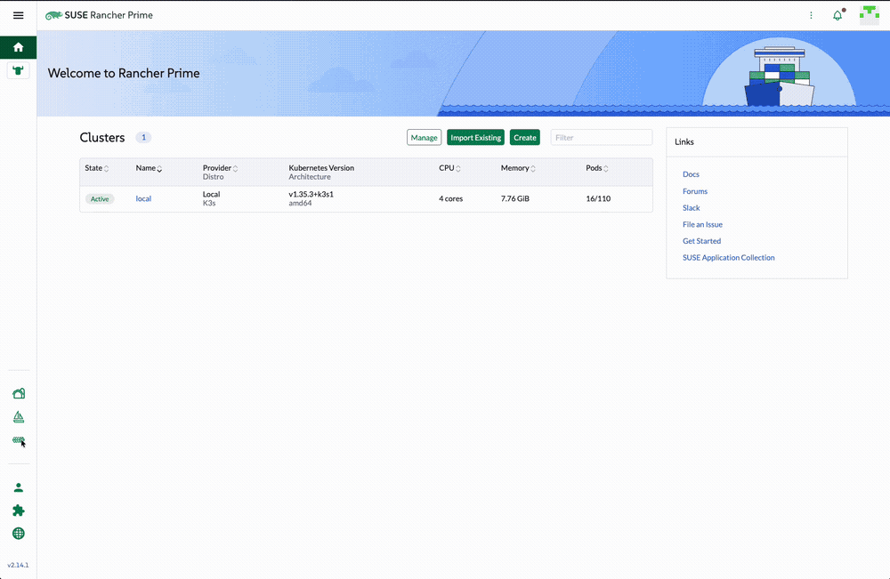
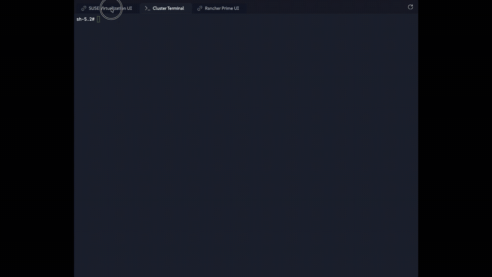

# Exercise 1: The Arrival

**Time:** 30 min  
**Next:** [Exercise 2: The Subterranean Divide](02-subterranean-divide.md)

---


Vertex Trust Bank is drowning in legacy hypervisor costs. Sarah, the CTO, hands you a fresh **SUSE Virtualization** (Harvester) cluster and a Rancher Prime instance that do not know about each other yet. Your first job: connect them, tour the UIs, and confirm you can drive the platform from a terminal.

After `rodeo up`, Harvester and Rancher are up; import is intentionally left for you. If your instructor gave you a lab through the claim portal, your lab page has the URLs, the passwords and the SSH command for your lab host. If you deployed the lab yourself, the passwords are in `~/.rodeo/secrets.yaml` on the KVM host (`harvester_admin_password`, `rancher_admin_password`).

| Field | Value |
|---|---|
| Username | `admin` |
| Harvester UI | `https://<host-ip>:8443` |
| Rancher UI | `https://<host-ip>:30002` |
| Passwords | your lab page, or `~/.rodeo/secrets.yaml` |

> **Note:** Both UIs use self-signed certificates. Accept the browser security warning when it appears.

## 1.1 Verify both backends

From a shell on the KVM host (on a claim-portal lab, that's your `ssh -p 2222 student@...` session):

```bash
curl -sk https://192.168.122.10/v1 | jq -r '.id'

# Rancher's /v3 requires a bearer token even for the root document; an
# anonymous GET (or HTTP Basic Auth) returns 401. Paste the Rancher password
# from your lab page when asked (it isn't echoed).
read -rsp 'Rancher password: ' RANCHER_PW; echo
RANCHER_TOKEN=$(curl -sk -X POST "https://192.168.122.9:30002/v3-public/localProviders/local?action=login" \
  -H 'Content-Type: application/json' \
  -d "{\"username\":\"admin\",\"password\":\"$RANCHER_PW\"}" | jq -r '.token')
curl -sk -H "Authorization: Bearer $RANCHER_TOKEN" https://192.168.122.9:30002/v3 | jq -r '.type'
```

Expect `v1` from Harvester and `apiRoot` from the authenticated Rancher call (that's the discovery root's own type; a specific listing like `/v3/clusters` would say `collection`).

> **Deployed the lab yourself?** Take the password from `grep '^rancher_admin_password:' ~/.rodeo/secrets.yaml` instead (anchor the grep: the file's comment header repeats each key name). `rodeo status` then shows the three Harvester nodes and the rancher VM; it needs libvirt access, so it doesn't work from a claim-portal student account.

## 1.2 Import Harvester into Rancher

1. Open Rancher at `https://<host-ip>:30002` and log in as `admin`.
2. Left sidebar → **Virtualization Management** → **Import Existing**.
3. Set **Cluster Name** to `harvester` (exact name, later exercises assume it).
4. Click **Create**, then copy the registration URL shown (`https://rancher.192-168-122-9.sslip.io:30002/v3/import/...yaml` or similar, ending in `.yaml`).

In the Harvester UI (`https://<host-ip>:8443`):

1. Left sidebar → **Settings** (gear).
2. Find **cluster-registration-url** → edit → paste the URL → check **Insecure Skip TLS Verify** (Rancher's cert is self-signed) → **Save**.



Wait 1-3 minutes. In Rancher → Virtualization Management the cluster moves `Pending` → `Waiting` → **Active**.

> **Important:** the cluster name must be exactly `harvester`. Later exercises assume it.

## 1.3 Tour the SUSE Virtualization dashboard

Open the Harvester UI (directly or via Rancher → Virtualization Management → **harvester**).



On the **Dashboard**, confirm:

- **Hosts** - three nodes
- **Virtual Machines** - `webserver-prod` and `daily-batch-processor` already running. Deploy automation pre-creates them as its last step; you'll use both in Exercise 4
- **Images**, **Volumes**, capacity and metrics panels
- Bottom-left **Support** → **Download KubeConfig** (save it, you need it in 1.5)
- **Generate Support Bundle** - know where it is for real incidents

Do not change anything yet. This exercise is orientation plus the import.

## 1.4 Meet Rancher Prime

Back in Rancher:

- **Cluster Management** still lists `local` (Rancher's own K3s).
- **Virtualization Management** now lists `harvester` as **Active**.

Rancher is the fleet commander: identity, multi-cluster, and later the place you provision guest Kubernetes. Harvester remains the place you run VMs.

## 1.5 Terminal access

Put the kubeconfig you downloaded in 1.3 on the KVM host as `~/.kube/config`, kubectl's default location. The simplest way: open the downloaded file in a text editor, copy all of it, then on the KVM host run:

```bash
mkdir -p ~/.kube && cat > ~/.kube/config   # paste, then press Ctrl+D
chmod 600 ~/.kube/config
```

(Or copy the file from your laptop. On a claim-portal lab: `ssh -p 2222 -i student-01.key student@<host-ip> mkdir -p .kube`, then `scp -P 2222 -i student-01.key local.yaml student@<host-ip>:.kube/config`.)

The downloaded file points at the address you opened the UI with, for example `https://<host-ip>:8443`. From the KVM host, kubectl has to talk to the cluster VIP instead, because the Harvester certificate only covers that address. Rewrite the server line:

```bash
sed -i 's#https://[^/]*/k8s#https://192.168.122.10/k8s#' ~/.kube/config
```

Then drive the cluster from the terminal:

```bash
kubectl get nodes
kubectl get pods -n harvester-system | grep -v Completed
```


All three nodes should be `Ready`. Core Harvester pods should be running. Every later terminal step in this workshop uses this kubeconfig.

> **Deployed the lab yourself?** You can also open a shell on a Harvester node: `sudo rodeo ssh harvester1`, then `sudo -E /var/lib/rancher/rke2/bin/kubectl --kubeconfig /etc/rancher/rke2/rke2.yaml get nodes`. That needs sudo on the KVM host, so it doesn't work from a claim-portal student account.

**Check your work:** `/opt/suse-virt-workshop/checks/check-exercise-1.sh`.

---

**Next:** [Exercise 2: The Subterranean Divide](02-subterranean-divide.md)
